# MMM-MyGarbage-BODK

A garbage collection calendar for [MagicMirror²](https://github.com/MagicMirrorOrg/MagicMirror), maintained by [BODK](https://github.com/BravoOscarDK).

Displays upcoming collection dates with Danish waste sorting pictograms. Icons and layout are included in the module; no icon configuration in `custom.css` is required.

## Installation

Clone the repository into your MagicMirror modules directory and install its dependencies:

```sh
cd ~/MagicMirror/modules
git clone https://github.com/BravoOscarDK/MMM-MyGarbage-BODK.git
cd MMM-MyGarbage-BODK
npm install
```

Use the Node.js version required by your MagicMirror² release. The code has been reviewed against MagicMirror² master, but the updated module has not yet been tested in a running MagicMirror² installation.

## Configuration

Add this entry to the `modules` array in MagicMirror's `config/config.js`:

```js
{
  module: "MMM-MyGarbage-BODK",
  position: "top_left",
  header: "Waste Collection",
  config: {
    language: "en",
    alert: 4,
    weeksToDisplay: 2,
    limitTo: 99,
    dateFormat: "dddd D MMMM",
    fade: true,
    fadePoint: 0.25
  }
}
```

Date labels follow this module's `language` option, which defaults to `"en"`. Use `language: "da"` in the module config for Danish. The wording inside the pictogram images remains Danish.

| Option | Description | Default |
| --- | --- | --- |
| `alert` | Warn when the number of remaining collection entries is at or below this threshold; use `false` to disable | `false` |
| `weeksToDisplay` | Number of weeks to display, starting today | `2` |
| `limitTo` | Maximum number of collection entries to display | `99` |
| `dateFormat` | Moment date format for dates at least a week away | `"dddd D MMMM"` |
| `fade` | Fade later collection entries | `true` |
| `fadePoint` | Point at which fading starts, from 0 to 1 | `0.25` |

## Collection schedule

Edit `garbage_schedule.csv` in the module directory. Use commas as separators and keep these column names:

```csv
WeekStarting,Farligt,Have,Stor,Pap,Papir,Plast,Drikke,Glas,Metal,Rest,Mad
11/02/26,0,0,0,0,0,0,0,0,0,1,1
11/04/26,0,0,0,0,1,1,1,0,0,0,0
```

- Dates use `MM/DD/YY`: `11/02/26` means November 2, 2026.
- Use `1` for a collection and `0` or an empty field for no collection.
- Each row represents one collection date.
- You can rearrange columns if you move each heading together with its values. Keep the headings unchanged, including capitalization.
- Rows are sorted by date automatically. Changing CSV column order does not change the icon order on screen.

The schedule is read every hour, so CSV edits do not require a restart. Empty periods display a message. File errors and invalid dates display an error message and are logged on the server.

`garbage_schedule_STANDARD.csv` is a reference template with helper comments. Remove those comments before using its rows in the live `garbage_schedule.csv`; the live CSV parser does not support trailing helper comments. Yearly backup files are kept locally and excluded from Git.

## Danish icons: Danish and English names

The 11 SVG files are stored in `imgs/`. Their filenames and printed labels remain Danish. The table follows the column order in the schedule.

| Icon | CSV column | Dansk | English |
| --- | --- | --- | --- |
|  | `Farligt` | Farligt affald | Hazardous waste |
|  | `Have` | Haveaffald | Garden waste |
|  | `Stor` | Storskrald | Bulky waste |
|  | `Pap` | Pap | Cardboard |
|  | `Papir` | Papir | Paper |
|  | `Plast` | Plast | Plastic |
|  | `Drikke` | Mad- og drikkekartoner | Food and beverage cartons |
|  | `Glas` | Glas | Glass |
|  | `Metal` | Metal | Metal |
|  | `Rest` | Restaffald | Residual waste |
|  | `Mad` | Madaffald | Food waste |

## Appearance

Colors, relative image paths and the 70 × 70 px icon size are defined in `MMM-MyGarbage-BODK.css`.

When upgrading from your previous setup, remove the old `.MMM-MyGarbage` icon block from `custom.css`.

## Validation

```sh
npm run check
```

This checks JavaScript syntax. Also verify the layout and collection dates on your MagicMirror.

## License

MIT. See [LICENSE](LICENSE) for copyright notices and license terms.

## Language

English is the default, independently of the MagicMirror global language. Set `language: "da"` in this module's `config` for Danish, or `language: "en"` for English. Unsupported languages fall back to English. Custom labels and device names retain their configured values. Technical logs and diagnostic errors are in English.

German (`de`), Swedish (`sv`) and Dutch (`nl`) collection translations are also supported.
